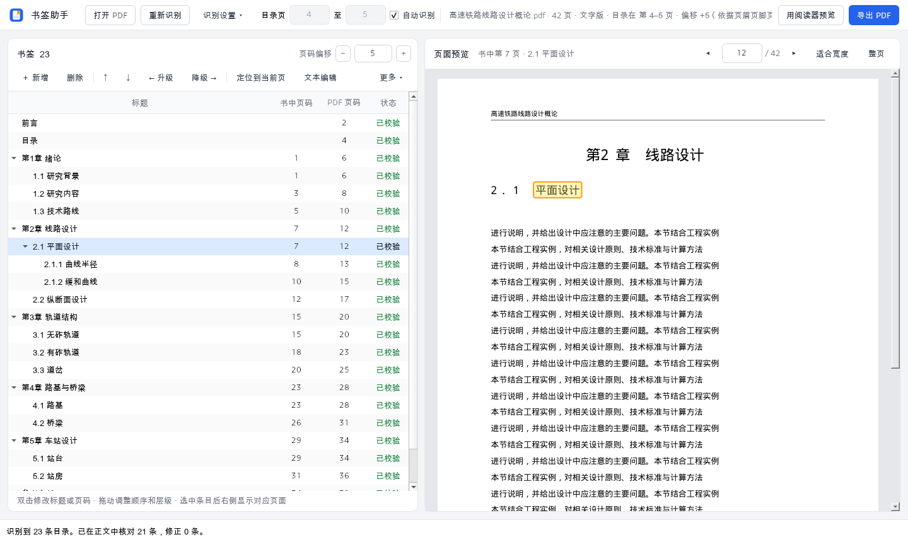
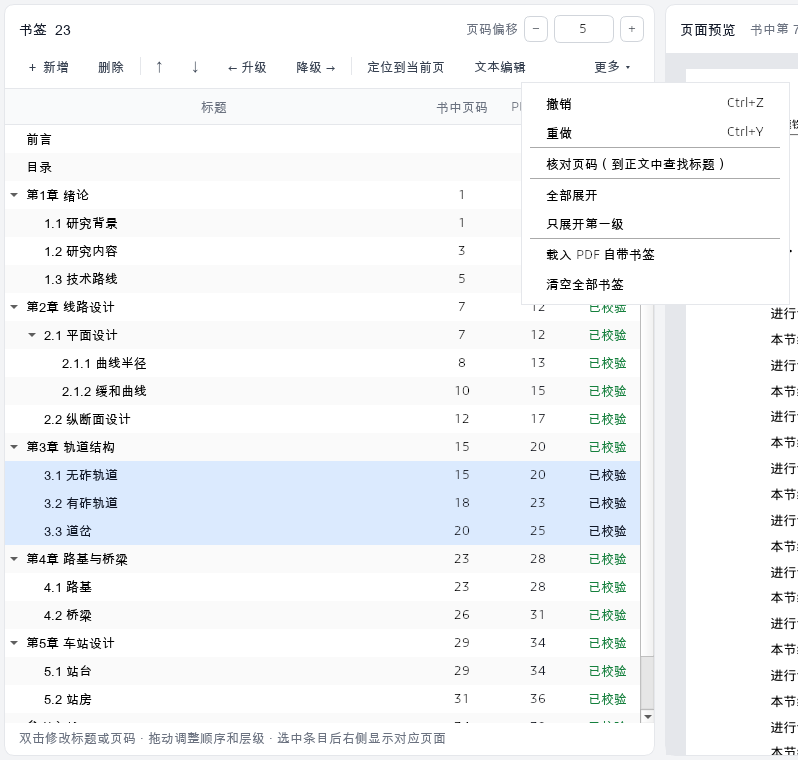
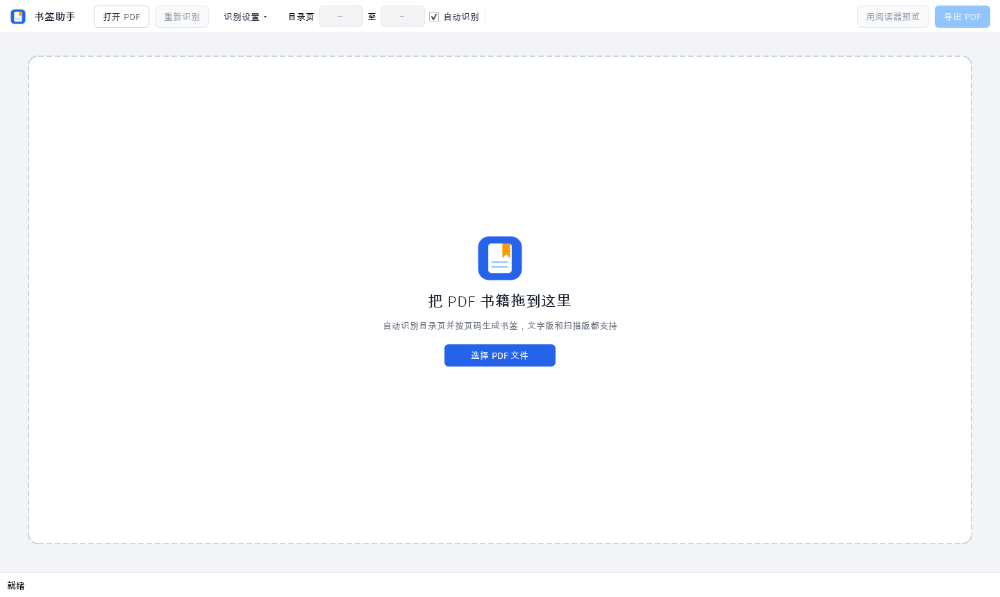
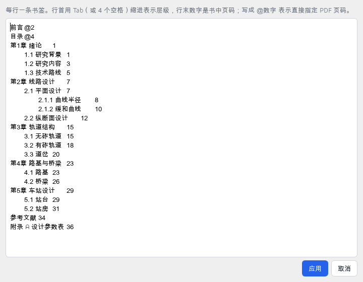
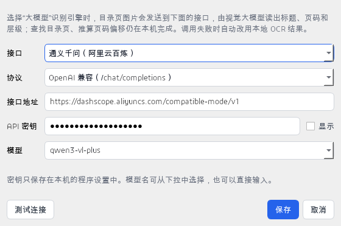
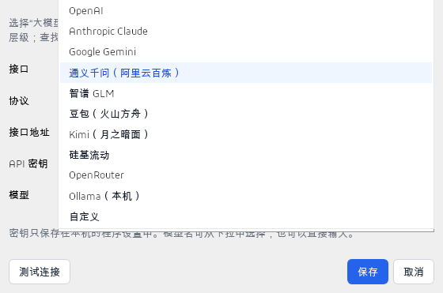

# PDF 目录书签助手 用户手册

本手册介绍程序的全部功能和使用方法。安装、运行和打包请看项目根目录的 [README](../README.md)。

---

## 目录

1. [它能做什么](#1-它能做什么)
2. [快速上手](#2-快速上手)
3. [界面总览](#3-界面总览)
4. [打开 PDF](#4-打开-pdf)
5. [识别目录](#5-识别目录)
6. [检查识别结果](#6-检查识别结果)
7. [编辑书签](#7-编辑书签)
8. [页码与页码偏移](#8-页码与页码偏移)
9. [文本编辑模式](#9-文本编辑模式)
10. [大模型识别](#10-大模型识别)
11. [预览与导出](#11-预览与导出)
12. [快捷键一览](#12-快捷键一览)
13. [常见问题](#13-常见问题)
14. [隐私与数据](#14-隐私与数据)

---

## 1. 它能做什么

很多电子书、扫描书、标准规范的 PDF 没有书签，阅读时只能来回翻目录。本程序会：

- **自动找到目录页**：在书的前部查找，找不到时再查看书的末尾。
- **读出每条目录**：取出标题、层级（章、节、小节……）和书中印刷的页码。
- **换算成 PDF 页码**：书中第 1 页往往不是 PDF 的第 1 页，因为前面还有封面、前言、目录。程序会自动算出两者的差值（页码偏移）。
- **到正文核对**：逐条到正文中查找标题，确认页码是否准确，个别错位的条目会自动修正。
- **导出新文件**：生成一个带可点击书签的新 PDF，**原文件不会被改动**。

文字版 PDF（能选中复制文字的）和扫描版 PDF（每页是图片的）都能处理。扫描版使用本机离线 OCR 识别，也可以选择交给视觉大模型识别。

---

## 2. 快速上手

最常见的流程只需四步：

1. **打开**：把 PDF 拖进窗口，或点顶栏的「打开 PDF」（Ctrl+O）。
2. **等待识别**：打开后程序立即开始识别。文字版一般一两秒；扫描版视电脑性能约 10–30 秒。
3. **检查**：在左侧书签列表中点几条，右侧会跳到对应页面，看位置对不对。
4. **导出**：点右上角「导出 PDF」（Ctrl+S），选择保存位置。默认文件名是「原文件名_书签.pdf」。

如果识别结果不完全正确，参见 [第 6 节](#6-检查识别结果) 至 [第 9 节](#9-文本编辑模式) 修改，或参见 [第 13 节](#13-常见问题) 排查。

---

## 3. 界面总览

打开 PDF 并识别完成后，界面如下：



界面分为四个区域：最上方是顶栏，左侧是书签面板，右侧是页面预览，最下方是状态栏。

### 顶栏

| 控件 | 作用 |
| --- | --- |
| 打开 PDF | 选择要处理的 PDF 文件（Ctrl+O） |
| 重新识别 | 按当前设置重新识别目录。识别进行中会变成红色的「终止识别」，点击即可终止 |
| 识别设置 ▾ | 强制 OCR、识别引擎（本地 / 大模型）、大模型接口设置。随时可以打开 |
| 目录页 [ ] 至 [ ] | 目录所在的 PDF 页码范围。识别后会自动填入找到的范围 |
| 自动识别 | 勾选时由程序查找目录页，左边的页码框变灰、不能编辑；取消勾选后才能手动填写 |
| 文件信息 | 文件名、总页数、类型（文字版 / 扫描版 / 混合）、目录位置、页码偏移及推算依据 |
| 用阅读器预览 | 生成临时文件，用系统默认的 PDF 阅读器查看书签实际效果 |
| 导出 PDF | 保存带书签的新 PDF（Ctrl+S） |

### 左侧：书签面板



- **标题栏**：显示书签总数和「页码偏移」。
- **工具栏**：新增、删除、上移、下移、升级、降级、定位到当前页、文本编辑、更多。
- **书签列表**：四列，分别是「标题」「书中页码」「PDF 页码」「状态」。PDF 页码显示为红色时，表示没有页码或页码超出了文件范围。

### 右侧：页面预览

- 「书中第 X 页」：当前预览页按页码偏移换算出的书中页码。若当前页正是选中书签指向的页，还会显示该书签的标题。
- ◀ ▶ 翻页，中间输入框可直接跳到指定的 PDF 页。
- 「适合宽度」「整页」切换缩放方式。按住 Ctrl 滚动鼠标滚轮可自由缩放。
- 滚动到页面底部后继续向下滚，会自动翻到下一页；在顶部向上滚则翻到上一页。

### 状态栏

显示当前操作的结果和提示。后台任务运行时会出现进度条和「取消」按钮。

---

## 4. 打开 PDF

打开方式有三种：

- 把 PDF 文件拖进窗口（空白页面或已打开文件的界面都可以）。
- 点「打开 PDF」或按 Ctrl+O。
- 命令行运行时把文件路径作为参数：`python app.py 书.pdf`。

打开时可能出现以下情况：

- **PDF 已加密**：会提示输入密码。
- **PDF 已经带有书签**：会询问「载入现有书签」还是「重新识别」。如果只想在原有书签基础上修改，选「载入现有书签」。
- **其他情况**：程序直接开始识别。

还没有打开文件时，窗口中间是一个拖放区域：



程序会记住上次打开文件的文件夹、窗口大小和左右面板的比例。

---

## 5. 识别目录

### 5.1 识别流程

1. **逐页读取文字**：页面有可用的文字层就直接读取，文字层为空或是乱码时改用 OCR。
2. **找目录页**：在书的前 40 页里查找，找不到时再查看最后几页。判断依据是「目录 / Contents」标题，或者大部分行的行尾是逐渐增大的页码。
3. **解析条目**：拆出标题和页码，合并跨行的长标题，并判断层级。
4. **推算页码偏移**：优先读取正文页眉、页脚上印的页码；读不到时，根据章节标题在正文中出现的位置推算。
5. **处理罗马数字页码**：前言等用 i、ii、iii 编页的部分单独推算页码。
6. **核对**：文字版会逐条到正文中查找标题，确认或修正页码。
7. **添加「目录」书签**：为目录页本身加一条书签。

### 5.2 层级是怎么判断的

程序优先按编号判断层级：

| 层级（由高到低） | 编号示例 |
| --- | --- |
| 篇 / 部 | 第一篇、第一部分、Part I |
| 章 | 第1章、Chapter 1、附录 A、「1、」或「1 」开头的标题 |
| 节 | 第一节、§1、一、 |
| 小节 | （一） |
| 点分编号 | 1.1、1.1.1……，点越多层级越深 |

- **没有编号的条目**：按它在目录页上的缩进位置，归入最接近的层级。
- **前言、绪论、参考文献、索引、后记、附录等**：放在第一级。

### 5.3 识别设置

点顶栏的「识别设置 ▾」可以修改：


- **强制使用 OCR**：有些文字版 PDF 的文字层编码有问题，复制出来是乱码。勾选后，程序忽略文字层，全部用 OCR 识别。
- **识别引擎**：
  - **本地识别（默认）**：完全在本机运行，不需要联网。
  - **大模型识别**：把目录页图片发给视觉大模型读取，详见 [第 10 节](#10-大模型识别)。
- **接口设置…**：配置大模型接口。下方灰字会显示当前接口和模型；配置不完整时会注明缺少什么。

识别引擎的选择会被记住，下次打开程序时沿用。

### 5.4 指定目录页范围

自动查找找错了或没找到目录页时：

1. 在右侧预览中翻到目录所在的页，记下 PDF 页码（预览顶部输入框里的数字）。
2. 取消勾选顶栏的「自动识别」。左边的两个页码框变为可编辑，光标自动进入第一个框。
3. 填写目录的起止页码。只填一个数时，当作只有那一页。
4. 点「重新识别」。

勾选「自动识别」时，页码框是灰色的，只显示上次找到的范围，不能编辑：


取消勾选后可以填写：


要回到自动查找，重新勾选「自动识别」即可，框里的页码会被忽略。

> 每次识别完成后，框里会填入本次找到的目录页范围，方便你确认。这不会改变「自动识别」的勾选状态。打开新文件时，范围会清空，并恢复为自动识别。

### 5.5 终止识别

识别进行中可以用两种方式终止：


- 点顶栏的「终止识别」。
- 点状态栏的「取消」。

终止后保留识别前的书签。使用大模型识别时，即使请求正在进行，也能立即终止。

---

## 6. 检查识别结果

### 6.1 逐条查看

- 在左侧列表中点击或用方向键选中任意一条书签，右侧会跳到它指向的 PDF 页。
- 文字版还会把该标题在页面上**标成黄色**，一眼就能看出位置对不对（见 [第 3 节](#3-界面总览) 的截图）。
- 书签没有页码或页码超出范围时，预览顶部会给出提示。

### 6.2 状态列

| 状态 | 颜色 | 含义 | 建议 |
| --- | --- | --- | --- |
| 已校验 | 绿 | 在正文对应页找到了这个标题，页码可信 | 一般无需检查 |
| 已修正 | 橙 | 按偏移算出的页上没有这个标题，但在前后一两页找到了，已自动调整 | 抽查一下 |
| 待确认 | 深橙 | 目录里这一条没有页码（如篇名），暂时沿用了下一条的页码；或前言部分的页码没能可靠推算 | 建议检查 |
| 手动 | 蓝 | 你修改过的条目 | — |
| 空白 | — | 没能在正文中核对，多见于扫描版 | 抽查，或运行「核对页码」 |

### 6.3 核对页码（扫描版）

- **文字版**：识别时会自动逐条核对。
- **扫描版**：核对需要对正文逐页 OCR，比较慢，所以不会自动运行。需要时点「更多 ▾ › 核对页码（到正文中查找标题）」。

核对时会在每条书签的目标页及前后两页中查找标题，并更新状态列。目录页本身和你手动改过的条目不参与核对。

### 6.4 其他查看操作

在「更多 ▾」菜单中：

- **全部展开**：展开所有层级。
- **只展开第一级**：只显示第一级，便于浏览整体结构。

---

## 7. 编辑书签

所有修改都可以用 **Ctrl+Z 撤销**、**Ctrl+Y（或 Ctrl+Shift+Z）重做**，最多保留 80 步。

### 7.1 修改标题和页码

双击单元格，或选中后按 F2，即可修改：

- **标题**：直接修改文字。清空时会显示为「（无标题）」。
- **书中页码**：书上印的页码。修改后，PDF 页码按「书中页码 + 页码偏移」重新计算。清空则表示这一条没有书中页码。
- **PDF 页码**：在 PDF 里实际跳转到的页。
  - 如果这一条有书中页码，程序会记住它与偏移计算结果的差值。以后调整页码偏移时，这条会跟着一起移动。
  - 如果没有书中页码，就固定指向你填写的页。

修改过的条目状态会变为「手动」。

### 7.2 选择多条

- 按住 **Ctrl** 点击：逐条加选。
- 按住 **Shift** 点击：选中一段连续的条目。

删除、升级、降级、定位到当前页都支持多选批量操作。

### 7.3 工具栏按钮

| 按钮 | 快捷键 | 作用 |
| --- | --- | --- |
| ＋ 新增 | Ctrl+N | 在当前条目之后新增一条同级书签，并直接进入标题编辑。新条目沿用当前条目的书中页码；当前条目没有书中页码或没有选中条目时，指向右侧正在预览的页 |
| 删除 | Delete | 删除选中的条目及其子项 |
| ↑ / ↓ | Ctrl+↑ / Ctrl+↓ | 在同级之间上移或下移当前条目 |
| ← 升级 | Ctrl+← | 提升一级。**支持多选批量** |
| 降级 → | Ctrl+→ | 降低一级，成为上一条的子项。**支持多选批量** |
| 定位到当前页 | Ctrl+G | 把选中条目的 PDF 页码设为右侧正在预览的页。**支持多选** |
| 文本编辑 | — | 以纯文本方式批量编辑整个目录，见 [第 9 节](#9-文本编辑模式) |

### 7.4 升级与降级的规则

升级、降级始终**保持书签的先后顺序不变**：

- **降级**：条目成为它上一条的子项。每一层最多比上一条深一级；列表的第一条不能降级。
- **升级**：条目提升一级，原来排在它后面的同级条目会变成它的子项。已经是最顶层的条目不能升级。
- **子项随父项移动**：条目的子项会跟着一起升级或降级。父项和子项同时选中时，整体只移动一级，不会重复移动。
- **批量操作**：选中多条后升级或降级，无法移动的条目会被跳过。状态栏会显示实际处理的条数和跳过的条数。

### 7.5 拖动调整

用鼠标拖动条目可以调整顺序：

- 拖到两条之间：插入到该位置。
- 拖到另一条**上面**：成为它的子项。

### 7.6 修正单条的页码

某一条指向的页不对时：

1. 选中这一条。
2. 在右侧用 ◀ ▶ 或滚轮翻到正确的页面。
3. 点「定位到当前页」（Ctrl+G）。

### 7.7 其他操作（「更多 ▾」菜单）

| 菜单项 | 作用 |
| --- | --- |
| 撤销 / 重做 | 同 Ctrl+Z / Ctrl+Y |
| 核对页码 | 到正文中逐条查找标题，见 [6.3](#63-核对页码扫描版) |
| 全部展开 / 只展开第一级 | 控制列表的展开程度 |
| 载入 PDF 自带书签 | 用文件原有的书签替换当前列表 |
| 清空全部书签 | 删除所有书签（会先确认，可撤销） |

---

## 8. 页码与页码偏移

### 8.1 三种页码

- **书中页码**：书上印的页码，也就是目录里写的数字。
- **PDF 页码**：在 PDF 阅读器里看到的第几页，从 1 开始。
- **页码偏移**：两者的差值。

> **PDF 页码 = 书中页码 + 页码偏移**
>
> 例：封面、前言、目录共占 12 页，书中第 1 页是 PDF 第 13 页，偏移就是 +12。

### 8.2 调整页码偏移

如果几乎所有书签都错了同样的页数，不需要逐条修改，只要调整左侧标题栏的「页码偏移」：

- 点 − / + 按钮，或在框内用鼠标滚轮、上下方向键调整。
- 所有条目的 PDF 页码会一起变化，右侧预览同步刷新。

顶栏的文件信息里会显示识别时推算出的偏移及推算依据，依据有三种：

- **页眉页脚页码**：读取正文页上印的页码推算，最可靠。
- **章节标题位置**：根据章节标题在正文中出现的位置推算。
- **估算**：以上两种方法都失败时，按「目录之后紧接正文」估算，请在预览中核对。

### 8.3 不受偏移影响的条目

以下条目直接指定 PDF 页码，调整页码偏移时**不会**跟着变化：

- 前言等罗马数字页码的条目：程序已单独换算成 PDF 页码。
- 「目录」书签本身。
- 没有书中页码、手动指定了 PDF 页码的条目。
- 从 PDF 自带书签载入的条目。

---

## 9. 文本编辑模式

条目很多、需要大改时，用「文本编辑」整体修改会更快。也可以把从别处复制来的目录粘贴进来。

### 9.1 格式

点工具栏的「文本编辑」，打开编辑窗口：



每行一条书签，例如：

```
第1章 总则	1
	1.1 适用范围	1
	1.2 术语	2
		1.2.1 基本术语	2
第2章 线路	5
附录 A	@258
```

- **层级**：行首用 Tab（或 4 个空格）缩进表示，每多一级缩进就深一级。
- **书中页码**：行末的数字，与标题之间至少隔一个空格或 Tab。
- **直接指定 PDF 页码**：行末写成 `@数字`，例如 `@258`。这种条目不受页码偏移影响。
- **不写页码**：沿用下一条的页码，状态标为「待确认」。
- **空行**：会被忽略。

层级不能跳级：比上一条深两级以上时，自动按深一级处理。

### 9.2 编辑后的效果

- 点「应用」后，用编辑后的文本替换整个书签列表。可以用 Ctrl+Z 撤销。
- 标题和页码都没改动的条目，会保留原来的核对状态和单条页码修正。
- 改动过的条目状态变为「手动」。

---

## 10. 大模型识别

扫描版目录如果字迹模糊、排版复杂，本地 OCR 可能出现错字或层级混乱。这时可以把目录页交给视觉大模型读取，通常效果更好。

### 10.1 工作方式

- **只有目录页的图片**会发送给大模型。图片的长边不超过 2000 像素，每次请求最多 4 页。
- 大模型返回每条目录的标题、页码和层级。
- 查找目录页、推算页码偏移、核对页码，仍然在本机完成。
- **调用失败时自动改用本地识别结果**，并在状态栏说明原因，不会导致识别中断。失败的情况包括网络不通、密钥错误、返回格式不对等。

### 10.2 配置步骤

1. 点「识别设置 ▾」，把「识别引擎」改为「大模型识别」。
2. 点「接口设置…」，在弹出的窗口中填写：

   


   | 项目 | 说明 |
   | --- | --- |
   | 接口 | 下拉选择服务商；选「自定义」可以接入其他服务 |
   | 协议 | 仅「自定义」时可选：OpenAI 兼容（`/chat/completions`）或 Anthropic（`/messages`） |
   | 接口地址 | 预设接口已自动填好，一般不用改；使用代理网关或私有部署时可修改 |
   | API 密钥 | 在服务商控制台申请。点「显示」可查看明文 |
   | 模型 | 可从下拉中选择推荐模型，也可以直接输入任意模型名。**必须是支持图片输入的模型** |

3. 点「测试连接」，确认显示「连接成功」。
4. 点「保存」，再点「重新识别」。

每个接口的地址、密钥和模型分别保存，切换接口不会互相覆盖。

「接口」下拉框中可以选择的服务商：



### 10.3 预置接口

| 接口 | 协议 | 默认地址 | 推荐模型 |
| --- | --- | --- | --- |
| OpenAI | OpenAI 兼容 | `https://api.openai.com/v1` | gpt-5.5、gpt-5.6、gpt-5-mini |
| Anthropic Claude | Anthropic | `https://api.anthropic.com/v1` | claude-sonnet-5-5、claude-opus-5-5、claude-haiku-5-5 |
| Google Gemini | OpenAI 兼容 | `https://generativelanguage.googleapis.com/v1beta/openai` | gemini-3.5-flash、gemini-3.1-pro-preview、gemini-flash-latest |
| 通义千问（阿里云百炼） | OpenAI 兼容 | `https://dashscope.aliyuncs.com/compatible-mode/v1` | qwen3-vl-plus、qwen3-vl-flash、qwen3.7-plus |
| 智谱 GLM | OpenAI 兼容 | `https://open.bigmodel.cn/api/paas/v4` | glm-4.6v、glm-4.6v-flash |
| 豆包（火山方舟） | OpenAI 兼容 | `https://ark.cn-beijing.volces.com/api/v3` | doubao-seed-1.6、doubao-1.5-thinking-vision-pro |
| Kimi（月之暗面） | OpenAI 兼容 | `https://api.moonshot.cn/v1` | kimi-k2.6、moonshot-v1-32k-vision-preview |
| 硅基流动 | OpenAI 兼容 | `https://api.siliconflow.cn/v1` | Qwen/Qwen3-VL-235B-A22B-Instruct、zai-org/GLM-4.6V |
| OpenRouter | OpenAI 兼容 | `https://openrouter.ai/api/v1` | openai/gpt-5.5、google/gemini-3.5-flash、anthropic/claude-sonnet-5.5 |
| Ollama（本机） | OpenAI 兼容 | `http://localhost:11434/v1` | qwen3-vl、gemma3（不需要密钥） |
| 自定义 | 可选 | 自行填写 | 自行填写 |

> 各服务商的模型名称更新频繁，表中仅供参考。若「测试连接」提示模型不存在，请到服务商控制台查看当前可用的模型名并手动输入。
>
> 豆包（火山方舟）部分账号需要填写在控制台创建的「推理接入点 ID」作为模型名。

### 10.4 关于接口地址

- 一般只需填写到版本号为止，例如 `https://api.openai.com/v1`。程序会自动补上 `/chat/completions` 或 `/messages`。
- 如果填写的是完整地址（已经以这两个路径结尾），程序会原样使用。

### 10.5 兼容性说明

不同服务商对请求参数的要求不同。例如 OpenAI 的 GPT-5 等推理模型，要求用另一个参数名指定输出长度，也不接受把温度设为 0。程序遇到这类参数错误时，会自动调整参数后重试，无需手动处理。

### 10.6 网络与代理

程序会自动使用系统代理（例如开启了「系统代理」的 Clash 等工具）。如果连接国外服务商失败，请确认代理已开启。使用 Ollama 等本机服务时，若连接失败，请确认代理软件的「绕过本地地址」设置包含 localhost / 127.0.0.1。

---

## 11. 预览与导出

### 11.1 用阅读器预览

点「用阅读器预览」，程序会生成一个临时文件，用系统默认的 PDF 阅读器打开。这样可以看到书签在真实阅读器里的样子，包括层级折叠、跳转位置等。临时文件保存在系统临时目录，不影响原文件。

### 11.2 导出 PDF

1. 点「导出 PDF」或按 Ctrl+S。
2. 选择保存位置。默认文件名是「原文件名_书签.pdf」，默认文件夹是上次导出的位置。
3. 导出完成后，可以选择「打开文件」或「打开所在文件夹」。

导出前会检查书签，有问题时先提示，可以选择继续或返回修改：

- **没有页码的条目**：会被跳过。
- **页码超出文件页数的条目**：会被限制到首页或末页。

导出的 PDF：

- 包含完整的书签层级。如果层级不连续，比如从第 1 级直接跳到第 3 级，会自动调整为逐级递进。
- 在阅读器中打开时会默认显示书签面板。
- 第一级以下的书签默认折叠。

> **覆盖原文件**：如果保存时选择了原文件本身，程序会先写入临时文件，成功后再替换原文件，避免写入中途出错导致文件损坏。即便如此，仍建议保存为新文件。

---

## 12. 快捷键一览

| 快捷键 | 功能 |
| --- | --- |
| Ctrl+O | 打开 PDF |
| Ctrl+S | 导出 PDF |
| Ctrl+Z | 撤销 |
| Ctrl+Y / Ctrl+Shift+Z | 重做 |
| Ctrl+N | 新增书签 |
| Delete | 删除选中的书签（焦点在书签列表时） |
| F2 / 双击 | 修改单元格 |
| Ctrl+↑ / Ctrl+↓ | 上移 / 下移 |
| Ctrl+← / Ctrl+→ | 升级 / 降级（支持多选） |
| Ctrl+G | 定位到当前预览页（支持多选） |
| PageUp / PageDown | 预览上一页 / 下一页 |
| Ctrl+鼠标滚轮 | 缩放预览 |

---

## 13. 常见问题

**没找到目录页 / 找错了目录页**

在顶栏「目录页」处填写目录所在的 PDF 页码范围，再点「重新识别」。详见 [5.4](#54-指定目录页范围)。

**标题是乱码**

文字层编码有问题。在「识别设置」里勾选「强制使用 OCR」后重新识别。

**所有页码都差几页**

调整「页码偏移」。详见 [8.2](#82-调整页码偏移)。

**只有个别条目页码不对**

选中该条，在右侧翻到正确的页，点「定位到当前页」（Ctrl+G）。

**前言部分（罗马数字页码）位置不准**

这部分的页码是单独推算的，状态可能为「待确认」。用「定位到当前页」逐条修正即可。

**扫描版识别出很多错字，或层级混乱**

- 可以改用大模型识别，见 [第 10 节](#10-大模型识别)。
- 错得不多时，用「文本编辑」整体修改会比逐条改更快。

**层级不对**

- 选中条目后用「← 升级 / 降级 →」调整。可以多选，一次处理一批。
- 也可以在「文本编辑」里直接调整缩进。

**识别时间太长**

扫描版需要 OCR，速度取决于电脑性能。等待期间可以随时点「终止识别」。如果知道目录在哪几页，先取消勾选「自动识别」并填写目录页范围，可以省去查找目录页的时间。

**大模型识别失败**

查看状态栏的提示：

- **401 / 403**：密钥错误或没有权限。
- **404**：接口地址或模型名错误。
- **无法连接**：网络或代理问题。

失败时已自动改用本地识别结果，不影响继续使用。可以在「接口设置」里点「测试连接」排查。

**PDF 已有书签，想在原来基础上修改**

打开文件时选「载入现有书签」。也可以随时通过「更多 ▾ › 载入 PDF 自带书签」载入。

**导出时提示有条目没有页码**

这些条目会被跳过。如果需要保留，先给它们填上页码，或用「定位到当前页」指定页面。

---

## 14. 隐私与数据

- **默认完全离线**：本地识别、编辑、导出全部在本机完成，不会上传任何内容。
- **大模型识别**：只有选择「大模型识别」时，才会把**目录页的图片**发送到你配置的接口；正文内容不会发送。使用 Ollama 等本机模型时，数据不会离开你的电脑。
- **密钥保存**：API 密钥以明文保存在本机的程序设置中（Windows 下为注册表 `HKEY_CURRENT_USER\Software\PdfBookmarker\PdfBookmarker`）。请勿在他人可访问的电脑上保存重要密钥。
- **原文件**：导出总是另存为新文件（除非你主动选择覆盖原文件），原 PDF 不会被修改。
